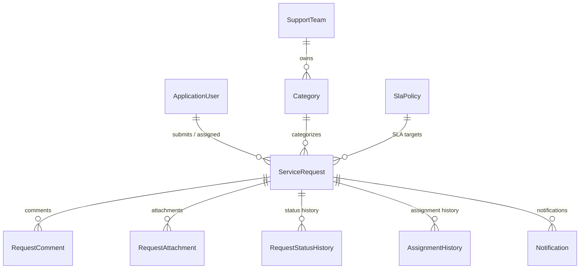

# Enterprise Service Management Portal (.NET MVC & Entity Framework Core)

An enterprise-grade Service Management & Ticketing Portal built with **ASP.NET Core MVC 10**, **Entity Framework Core**, and **SQL Server**. The system implements Clean Architecture principles with role-based access control (RBAC), Service Level Agreement (SLA) calculation engines, automated background services, comprehensive audit logging, and responsive UI design.

> 📘 **Detailed Guide**: A complete walkthrough of the business scenario, architecture layers, OOP/SOLID concepts, workflow rules, and DB schema is available in [`docs/project_explanation.md`](./docs/project_explanation.md).

---

## Key Features

###  1. Authentication & Role-Based Access Control (RBAC)
- **Identity System**: Integrated ASP.NET Core Identity for secure authentication.
- **Roles**:
  - `Administrator`: Full access to configure support teams, SLA policies, manage users, and view audit logs.
  - `TeamLead`: Manage team queues, assign tickets to agents, monitor SLA breaches, and reassign requests.
  - `SupportAgent`: Work on assigned tickets, update status, add internal notes/public responses, and resolve requests.
  - `Requester`: Submit service requests, track request history, and communicate with support teams.

### 2. Service Request Management
- **Categorization**: Multi-tiered category assignment tied to dedicated support teams (IT Support, HR Services, Facilities).
- **Priority & SLA Tracking**: Automated SLA calculation based on priority (`Low`, `Medium`, `High`, `Critical`) and configured target resolution hours.
- **Status Workflow**: Strict state machine transitions (`New` → `In Progress` → `Pending Input` → `Resolved` → `Closed` / `Cancelled`).
- **Audit History**: Full audit trail tracking every status change, assignment update, and user comment.

### 3. Automated Background Services (`IHostedService`)
- **SLA Breach Monitoring Service**: Periodically scans active tickets for upcoming SLA deadlines and flags breached requests automatically.
- **Auto-Close Service**: Automatically transitions resolved tickets to `Closed` status after a 48-hour auto-resolution grace period.

### 4. Reporting & Analytics Dashboard
- Interactive charts and KPI metrics displaying ticket counts, SLA compliance percentage, average resolution times, and team performance breakdowns.

---

## Clean Architecture & Project Structure

The project follows Clean Architecture patterns, separating responsibilities into distinct layers:

```
src/
├── ServicePortal.Domain/          # Core Domain Entities, Enums, & Interfaces (No Dependencies)
├── ServicePortal.Application/     # Application Services, Business Logic, SLA Engines
├── ServicePortal.Infrastructure/  # EF Core DbContext, Migrations, Repositories, Seeder
└── ServicePortal.Web/             # ASP.NET Core MVC Controllers, Views, ViewModels, SignalR
tests/
├── ServicePortal.UnitTests/       # Unit Test Suite for Domain & Business Services
└── ServicePortal.IntegrationTests/# Integration Test Suite for End-to-End Scenarios
```

---

## Entity Relationship Diagram (ERD)

Full documentation and table relationships are detailed in [`docs/er-diagram.md`](./docs/er-diagram.md).



---

## Database Setup (SQL Server / SSMS)

The application uses **Entity Framework Core** with **Microsoft SQL Server Express**.

### Connection String
The default connection string in `src/ServicePortal.Web/appsettings.json` points to local SQL Server Express:
```json
"ConnectionStrings": {
  "DefaultConnection": "Server=localhost\\SQLEXPRESS;Database=ServicePortalDB;Trusted_Connection=True;TrustServerCertificate=True;MultipleActiveResultSets=true;"
}
```

### Applying Migrations via EF Core
Run the following command to apply database migrations and automatically seed initial roles, teams, categories, SLA policies, and demo users:
```bash
dotnet ef database update --project src/ServicePortal.Infrastructure --startup-project src/ServicePortal.Web
```

### Running Standalone SQL Script in SSMS
Alternatively, a complete standalone database setup script [`ServicePortalDB_Setup.sql`](./ServicePortalDB_Setup.sql) is included in the project root. You can execute this file directly inside **SQL Server Management Studio (SSMS)**.

---

## Getting Started

### Prerequisites
- [.NET 10.0 SDK](https://dotnet.microsoft.com/download) (or .NET 8/9 SDK)
- [SQL Server Express / SQL Server LocalDB](https://www.microsoft.com/sql-server/)
- [SQL Server Management Studio (SSMS)](https://learn.microsoft.com/sql/ssms/download-sql-server-management-studio-ssms) (Optional)

### Run the Application
1. Clone the repository:
   ```bash
   git clone <repository-url>
   cd "C# .NET"
   ```
2. Restore packages and build solution:
   ```bash
   dotnet build src/ServicePortal.Web/ServicePortal.Web.csproj
   ```
3. Run database migrations:
   ```bash
   dotnet ef database update --project src/ServicePortal.Infrastructure --startup-project src/ServicePortal.Web
   ```
4. Start the web application:
   ```bash
   dotnet run --project src/ServicePortal.Web/ServicePortal.Web.csproj
   ```
5. Open browser at `https://localhost:7001` or `http://localhost:5000`.

---

##  Running Unit & Integration Tests

Execute the complete test suite using dotnet CLI:
```bash
dotnet test ServicePortal.slnx
```

---

##  Copilot & AI Utilization Report

- **Architecture Design**: Used AI pair programming to design Clean Architecture layers and enforce SOLID principles across assemblies.
- **EF Core Optimization**: Optimized entity configurations, indexes, concurrency tokens, and SQL Server foreign key delete behaviors.
- **Workflow Automation**: Built background services for SLA compliance and auto-resolution workflows with dependency injection scoping.

---

## License
Distributed under the MIT License.
