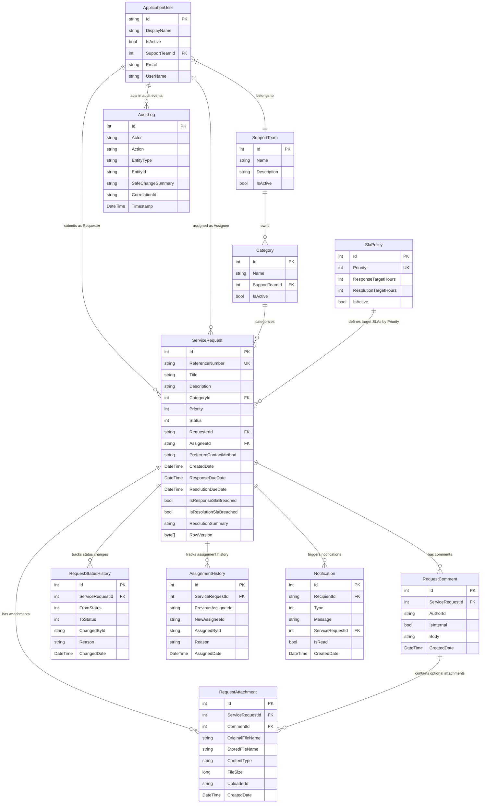

# Entity Relationship Diagram (ERD)

The following diagram illustrates the relational data model for the **Smart Service Request Management Portal (SSRMP)** using Entity Framework Core & SQL Server.

---

## Data Model Relationship Details

| Relationship | Parent Entity | Child Entity | Foreign Key | Delete Behavior |
| :--- | :--- | :--- | :--- | :--- |
| **Request Category** | `Category` | `ServiceRequest` | `CategoryId` | `Restrict` |
| **Team Categories** | `SupportTeam` | `Category` | `SupportTeamId` | `Restrict` |
| **Request Comments** | `ServiceRequest` | `RequestComment` | `ServiceRequestId` | `Cascade` |
| **Request Attachments** | `ServiceRequest` | `RequestAttachment` | `ServiceRequestId` | `Restrict` (Prevents SQL Server multiple cascade paths) |
| **Comment Attachments**| `RequestComment` | `RequestAttachment` | `CommentId` | `SetNull` |
| **Status Audit History**| `ServiceRequest` | `RequestStatusHistory` | `ServiceRequestId` | `Cascade` |
| **Assignment Audit** | `ServiceRequest` | `AssignmentHistory` | `ServiceRequestId` | `Cascade` |
| **Notifications** | `ServiceRequest` | `Notification` | `ServiceRequestId` | `SetNull` |
