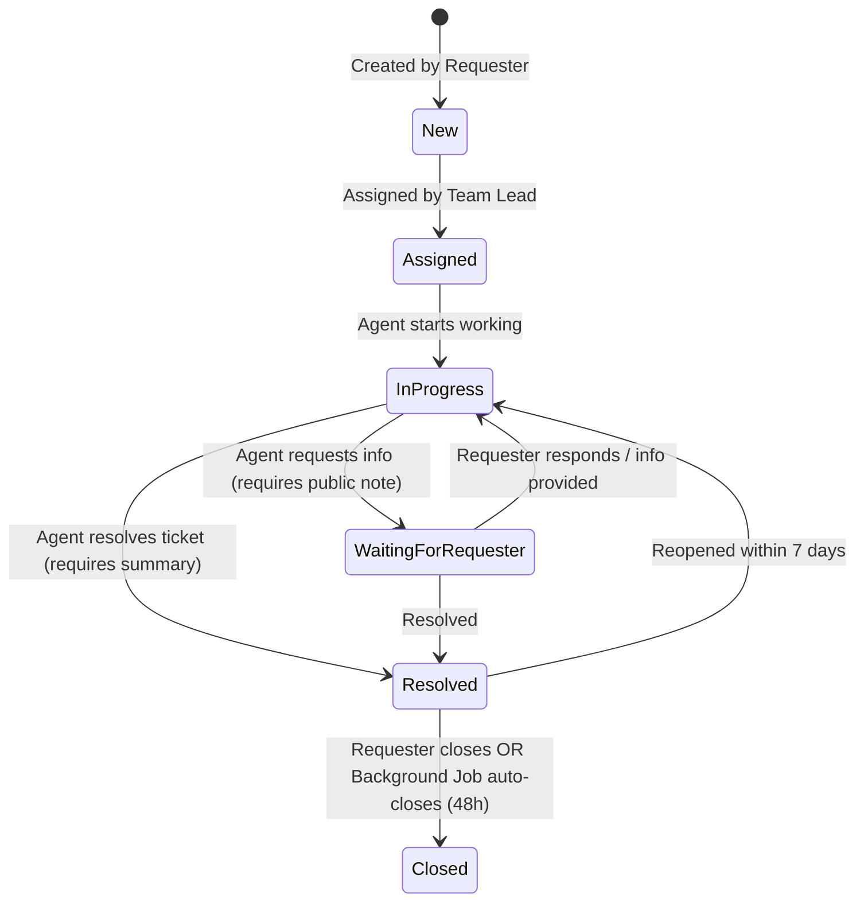

# Project Explanation & Comprehensive Guide

## Executive Summary & Business Scenario

The **Smart Service Request Management Portal (SSRMP)** is an enterprise-grade web application built using **ASP.NET Core MVC 10**, **Entity Framework Core**, and **Microsoft SQL Server**.

### The Problem Statement
Contoso Support Services previously received IT, Facilities, HR, and General support requests through unorganized channels like emails and spreadsheets. This led to:
- Duplicate service requests.
- Tickets assigned to incorrect teams or unassigned indefinitely.
- No SLA (Service Level Agreement) compliance tracking or visibility into team workloads.
- Lack of audit trails, history logs, or resolution metrics.

### Solution Overview
The SSRMP provides a centralized, role-based platform that enforces strict ticket lifecycles, automated team routing, SLA breach detection, background auto-closures, comprehensive audit logging, and responsive reporting dashboards.

---

## 🏗️ Architecture & Layer Breakdown

The project follows **Clean Architecture** (Separation of Concerns):

```
src/
├── ServicePortal.Domain/          # Layer 1: Core Domain Entities, Enums, & Interfaces
├── ServicePortal.Application/     # Layer 2: Business Rules, SLA Engines, Workflow Services
├── ServicePortal.Infrastructure/  # Layer 3: EF Core DbContext, Identity, SQL Server Setup, Database Seeder
└── ServicePortal.Web/             # Layer 4: ASP.NET Core MVC Controllers, Razor Views, Background Services
tests/
├── ServicePortal.UnitTests/       # xUnit Unit Test Suite
└── ServicePortal.IntegrationTests/# Integration Test Suite
docs/
├── er-diagram.md                  # Entity Relationship Diagram & Schema Tables
├── architecture.md                # System Architecture & Security Documentation
└── project_explanation.md         # Comprehensive Project Guide & Walkthrough
```

### Layer Details:

1. **`ServicePortal.Domain` (Core Layer)**:
   - Contains domain entities (`ServiceRequest`, `SupportTeam`, `Category`, `RequestComment`, `RequestAttachment`, `RequestStatusHistory`, `AssignmentHistory`, `SlaPolicy`, `Notification`, `AuditLog`).
   - Defines interfaces (`IWorkflowService`, `ISlaCalculationService`, `IEmailService`) so high-level logic depends on abstractions, not implementations (Dependency Inversion).

2. **`ServicePortal.Application` (Business Logic Layer)**:
   - **`WorkflowService`**: Implements state-machine rules validating valid transitions (`New` → `Assigned` → `InProgress` → `WaitingForRequester` → `Resolved` → `Closed`).
   - **`SlaCalculationService`**: Calculates target SLA deadlines based on business hours (Mon-Fri 09:00 - 18:00), automatically skipping weekends.

3. **`ServicePortal.Infrastructure` (Data & Identity Layer)**:
   - **`ApplicationDbContext`**: EF Core database context configuring SQL Server mappings, indexes, concurrency tokens (`RowVersion`), and foreign key cascade rules (`DeleteBehavior.Restrict` on attachments to prevent SQL Server Error 1785).
   - **`DatabaseSeeder`**: Automatically seeds initial roles, support teams, categories, SLA policies, and synthetic demo users upon application startup.

4. **`ServicePortal.Web` (Presentation & Background Layer)**:
   - **MVC Controllers**: `ServiceRequestsController` handles dashboard queries, ticket creation, status transitions, staff assignments, comments, and CSV export.
   - **Background Services (`IHostedService`)**:
     - `SlaBreachCheckerService`: Periodically checks active tickets against SLA deadlines and marks breaches automatically.
     - `AutoCloseResolvedRequestsService`: Automatically closes resolved tickets after the 48-hour grace period.

---

## 🧠 Key Technical Concepts & Design Patterns

### 1. Object-Oriented Programming (OOP) Concepts
- **Inheritance**: `ApplicationUser : IdentityUser` extends built-in ASP.NET Core Identity with custom fields (`DisplayName`, `SupportTeamId`, `IsActive`).
- **Encapsulation**: Domain entity properties encapsulate business state and relationships.
- **Polymorphism**: `WorkflowService` and `SlaCalculationService` implement domain interfaces, allowing alternate implementations (e.g., test mocks) to be substituted seamlessly.
- **Abstraction**: Interfaces isolate callers from implementation details.

### 2. SOLID Principles
- **Single Responsibility Principle (SRP)**: Controllers handle HTTP requests; `WorkflowService` manages state rules; `SlaCalculationService` handles time calculations.
- **Open/Closed Principle (OCP)**: Services are extendable via interfaces without modifying core entity structures.
- **Liskov Substitution Principle (LSP)**: `ApplicationUser` can be substituted wherever `IdentityUser` is accepted.
- **Interface Segregation Principle (ISP)**: Interfaces (`ISlaCalculationService`, `IWorkflowService`) are focused and purpose-specific.
- **Dependency Inversion Principle (DIP)**: Controllers and background services depend on interface abstractions injected via ASP.NET Core Dependency Injection (DI).

---

## 🔄 Ticket Lifecycle & Workflow Rules



---

## 🔒 Security & Role-Based Access Control (RBAC)

| Role | Access Permissions |
| :--- | :--- |
| **Administrator** | Full system control: Manage users, roles, teams, SLA policies, and view audit logs. |
| **TeamLead** | View team request queue, assign/reassign tickets to agents, monitor SLA compliance. |
| **SupportAgent** | Work on assigned requests, update ticket status, post public responses & internal notes. |
| **Requester** | Submit requests, view own ticket progress, post public comments, close/reopen own tickets. |

- **IDOR Protection**: Non-staff users are strictly scoped to `RequesterId == currentUserId` on all server-side controller queries.
- **CSRF Protection**: All form post actions carry `[ValidateAntiForgeryToken]`.
- **Concurrency Control**: EF Core `[Timestamp] byte[] RowVersion` token prevents silent overwrites during concurrent updates.

---

## 📊 Database Setup & SSMS Integration

The project is configured for **Microsoft SQL Server Express** (`localhost\SQLEXPRESS`).

1. **Connection String (`appsettings.json`)**:
   ```json
   "DefaultConnection": "Server=localhost\\SQLEXPRESS;Database=ServicePortalDB;Trusted_Connection=True;TrustServerCertificate=True;MultipleActiveResultSets=true;"
   ```
2. **EF Core Migrations**: Run `dotnet ef database update` to automatically create `ServicePortalDB` and seed initial data.
3. **Standalone SQL Script**: [`ServicePortalDB_Setup.sql`](../ServicePortalDB_Setup.sql) is available in the workspace root for direct execution in **SQL Server Management Studio (SSMS)**.

---

## 🧪 Testing & Quality Assurance

- **Unit Tests (`tests/ServicePortal.UnitTests`)**: Automated xUnit tests covering `WorkflowService` transitions, `SlaCalculationService` business hours calculations, and validation rules.
- **Integration Tests (`tests/ServicePortal.IntegrationTests`)**: Tests covering database operations and end-to-end workflows.
- Run tests via CLI:
  ```bash
  dotnet test ServicePortal.slnx
  ```
